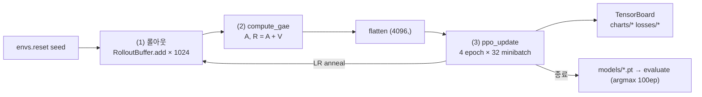

# 코드 맵 — src/ppo.py ↔ PPO 알고리즘

**상태**: active
**마지막 업데이트**: 2026-10-28
**관련 페이지**: [../features/requirements.md](../features/requirements.md), [../glossary.md](../glossary.md)

## 요약
한 iteration = **롤아웃 수집 → 어드밴티지 계산 → K 에폭 최적화**. 각 단계가 함수 하나에 대응한다.

## 파일 구성

| 파일 | 역할 | 단계 |
|---|---|---|
| `src/baseline_sb3.py` | SB3 PPO 기준선 (`--preset zoo|cleanrl`) | Stage 1 |
| `src/ppo_annotated.py` | CleanRL 원본 + 한국어 주석, Gymnasium 1.x 최소 수정 3곳(`# [수정]`) | Stage 2 |
| `src/ppo.py` | **최종 산출물.** 프로젝트 내부 import 없음 | Stage 3 |
| `src/evaluate.py` | `.pt`/`.zip` 일괄 평가 + 마크다운 표 출력 | 공통 |

## src/ppo.py 섹션

| 섹션 | 함수/클래스 | 메모 |
|---|---|---|
| Config | `DEFAULTS`, `parse_args` | 우선순위: DEFAULTS < `--config` JSON < CLI. `_` 로 시작하는 JSON 키(`_description`)는 무시, 모르는 키는 에러 |
| Seeding | `set_seed`, `pick_device` | mps/cuda 불가 시 cpu 폴백 |
| Env | `make_env`, `make_vec_env` | RecordEpisodeStatistics 를 NormalizeReward **안쪽**에 둬서 episodic_return 은 원시 보상 |
| Network | `layer_init`, `mlp`, `Agent` | 직교 초기화, 정책 출력 std 0.01 / 가치 출력 std 1.0 |
| Buffer | `RolloutBuffer` | `dones[t]` = obs[t] 가 새 에피소드 첫 관측 (CleanRL 규약) |
| Advantage | `compute_gae`, `compute_mc_returns` | 순수 함수 → 테스트 용이 |
| Update | `ppo_update`, `explained_variance` | `clip_policy=False` 면 비클리핑 surrogate (ablation) |
| Loop | `train` | SPS 는 1초 간격 기록 |
| Eval | `load_agent`, `evaluate` | 평가 시드 10000+ep (학습 시드와 분리) |

## CleanRL 대비 차이 (의도적)
1. 버퍼/GAE/업데이트를 함수로 분리 (CleanRL 은 `__main__` 한 블록)
2. `norm_reward`, `use_gae`, `clip_policy` ablation 스위치
3. `envs.action_space.seed` 추가 (PRD 리스크 표 "action_space 시드")
4. `torch_threads=1` (작은 MLP 에서 더 빠르고 결정적)
5. 학습 종료 시 저장 + 자동 100ep 평가

## 출처
- `src/ppo.py`, raw/research/cleanrl_ppo_fe8d8a0.py.txt
